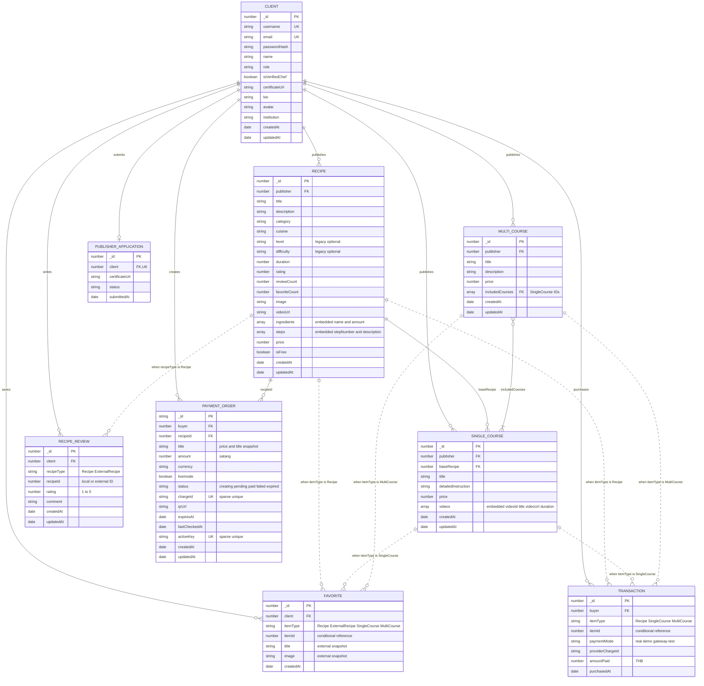

# ER Diagram — CookHub

อ้างอิง Mongoose models ในโปรเจกต์ ณ วันที่ 13 ตุลาคม 2026 เป็นโครงสร้างที่เก็บจริงใน MongoDB ไม่ใช่การเสนอเปลี่ยนฐานข้อมูล

## วิธีอ่าน

เส้นทึบแสดง ref ระหว่าง collection เส้นประแสดงความสัมพันธ์แบบเลือกชนิดด้วย itemType/recipeType โดยรายการหนึ่งอ้างถึงแหล่งเดียว ไม่ได้อ้างถึงทั้งสามแหล่งพร้อมกัน FK ในภาพเป็นความสัมพันธ์เชิงตรรกะ/ค่า ref ของ Mongoose ไม่ใช่ foreign key constraint แบบ SQL

ingredients, steps และ videos เป็น embedded arrays ไม่ใช่ collection แยก includedCourses เป็น array ของ ID คอร์สเดี่ยว แพ็กหนึ่งต้องมีอย่างน้อยหนึ่งคอร์ส ส่วนคอร์สเดี่ยวอยู่ได้หลายแพ็กหรือไม่อยู่ในแพ็กเลย

ExternalRecipe มาจาก TheMealDB ไม่มี model/collection ใน MongoDB จึงไม่วาดเป็นตารางจริง Favorite เก็บ ID พร้อมชื่อและรูป snapshot ส่วน RecipeReview เก็บ external ID แยกด้วย recipeType

PaymentOrder ไม่ได้มี Transaction ID เป็น ref โดยตรง เมื่อยืนยันชำระเงินสำเร็จระบบสร้าง Transaction และบันทึก providerChargeId ให้ตรงกับ chargeId ความเชื่อมโยงนี้ตรวจใน service ไม่ใช่ FK และไม่มี unique index บน providerChargeId

level/difficulty ยังอยู่ใน schema สำหรับข้อมูลเก่า แต่ระบบสูตรไม่ตั้งหรือกรองด้วยค่านี้แล้ว รูป avatar/image เป็น URL ไม่ได้เก็บไฟล์ cloud เป็น collection

## ดัชนีไม่ให้ข้อมูลซ้ำ

- Client.email ไม่ซ้ำ และ username ไม่ซ้ำเมื่อมีค่า (sparse)
- PublisherApplication.client ไม่ซ้ำ: ผู้ใช้หนึ่งคนมีใบสมัครได้สูงสุดหนึ่งรายการ
- Favorite: client + itemType + itemId ไม่ซ้ำ
- Transaction: buyer + itemType + itemId ไม่ซ้ำ
- RecipeReview: client + recipeType + recipeId ไม่ซ้ำ
- PaymentOrder: activeKey และ chargeId ไม่ซ้ำเมื่อมีค่า (sparse)

## Collection ของระบบ

Counter มี _id แบบ string และ seq แบบ number ใช้สร้าง ID ตัวเลขของ model ต่าง ๆ ไม่มี ref กับ collection ธุรกิจโดยตรง Session เก็บผ่าน connect-mongo เป็นข้อมูลเข้าสู่ระบบ จึงไม่รวมในภาพธุรกิจ

models/home.js เป็น Express router ไม่ใช่ Mongoose model จึงไม่ใส่เป็น entity และบทสนทนาน้องอุ่นเก็บใน sessionStorage ฝั่งเบราว์เซอร์ ไม่ใช่ collection ของแอป

ไฟล์ต้นฉบับ Mermaid สำหรับนำไปแก้หรือ render: [ERD.mmd](ERD.mmd)
